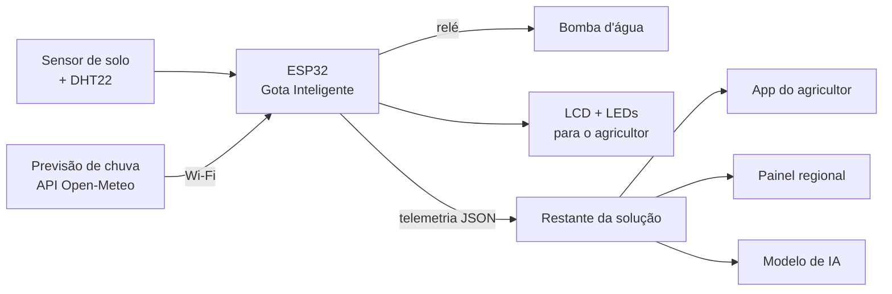
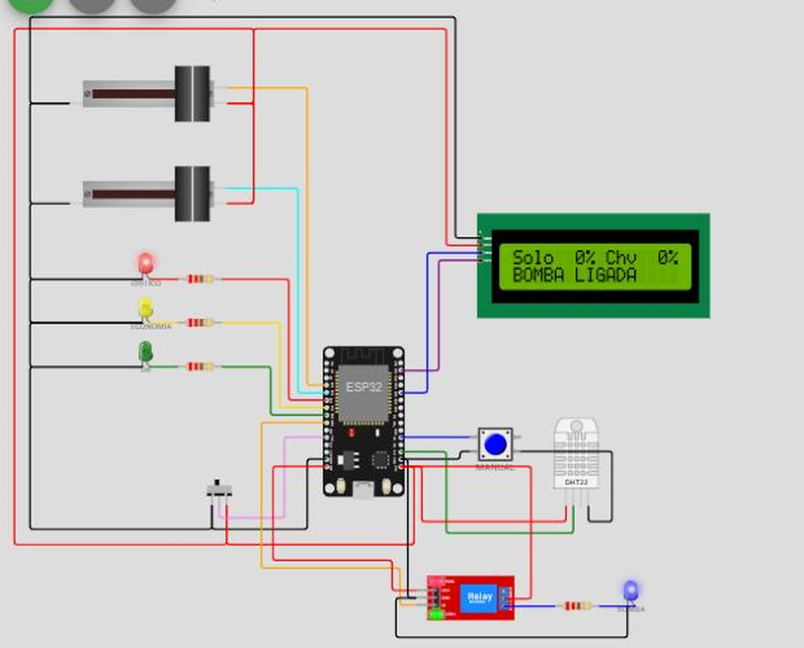
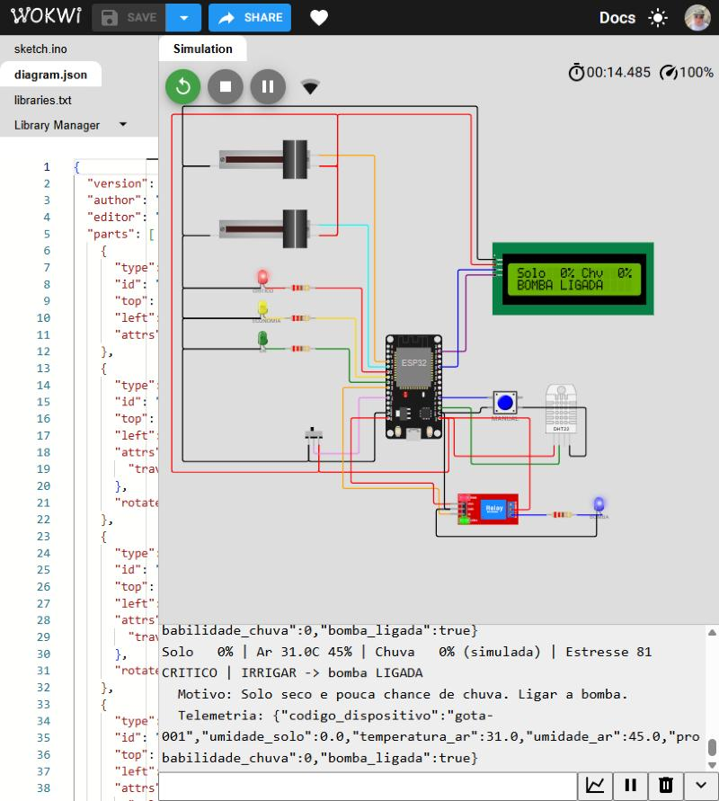

# 💧 Gota Inteligente — Kit IoT de irrigação (ESP32 + Wokwi)

Entrega de **Physical Computing (IoT & IoB)** da Global Solution 2026.2 (FIAP · Engenharia de Software · 3º ano).

| | |
|---|---|
| 🔗 **Projeto no Wokwi** | https://wokwi.com/projects/480869188509119489 |
| 🎬 **Vídeo demonstrativo** | LINK_VIDEO |

### 📦 Entregáveis pedidos na atividade

| Pedido no enunciado | Onde está |
|---|---|
| Detalhes da solução apresentada | [Ficha da CitizenTech](#-ficha-da-citizentech) e [Como o IoT agrega valor](#-como-o-iot-agrega-valor-à-gota-inteligente) |
| Nomes dos integrantes | [Integrantes](#-integrantes) e `integrantes.txt` |
| Imagens da montagem | [Circuito](#-circuito) e pasta `docs/imagens/` |
| Códigos | `firmware/sketch/sketch.ino` (e o circuito em `diagram.json`) |
| Vídeo demonstrativo | link no topo desta página |
| Link do projeto no Wokwi | link no topo desta página |
| Todos os integrantes como coautores | registrados no commit (`Co-authored-by`) |

---

## 📋 Ficha da CitizenTech

| | |
|---|---|
| **Nome** | Gota Inteligente |
| **Território** | Cinturão verde de São Paulo (ex.: Ibiúna, Piedade, Mogi das Cruzes) |
| **Cidadão beneficiado** | O agricultor familiar |
| **Problema, em uma frase** | O pequeno produtor desperdiça água e energia regando "no olhômetro", ou perde a plantação numa seca repentina. |
| **Solução** | Um assistente de irrigação de baixo custo que cruza os dados do solo com a previsão do tempo e decide quando ligar a bomba. |
| **Indicador de impacto** | Irrigações evitadas quando a chuva vem (água e energia economizadas) e tempo com o solo em estresse hídrico crítico |
| **ODS conectados** | **ODS 2** (Fome zero e agricultura sustentável) · **ODS 6** (Água potável e saneamento) · **ODS 13** (Ação contra a mudança do clima) |

## 👥 Integrantes

| Nome | RM |
|---|---|
| Henrique Maciel Rodrigues | RM559628 |
| Igor Pereira Nociti | RM560225 |
| João Pedro Vieira de Moais | RM560527 |
| Luigi Bonuccelli | RM560950 |
| Pedro Paulo Sabino Botelho | RM559578 |

---

## 🌱 Como o IoT agrega valor à Gota Inteligente

O kit ESP32 é **o coração da solução**: é ele que fica no campo, mede o solo e liga ou desliga a bomba d'água. Sem ele, o agricultor continua regando no "olhômetro".

| Sem o kit | Com o kit Gota Inteligente |
|---|---|
| Liga a bomba todo dia no mesmo horário, chova ou não | Mede a umidade do solo de verdade, a cada 2 segundos |
| Rega e, duas horas depois, chove: água e energia jogadas fora | Consulta a previsão de chuva e **segura a bomba** quando vai chover |
| Numa seca repentina, só percebe quando a planta murcha | Detecta o **estresse hídrico crítico** e irriga na hora, mesmo com chuva prevista |
| Nenhum histórico | Gera a telemetria de cada leitura (JSON), no formato usado pelo app do agricultor e pelo painel regional |

Ele também **funciona sem internet**, o que é comum no campo: as regras de decisão rodam no próprio ESP32 e, se o Wi-Fi cair, o kit continua decidindo com os sensores.

### Onde o kit entra na solução



---

## 🔌 Circuito



| Componente | Pino do ESP32 | Papel na solução |
|---|---|---|
| Potenciômetro deslizante **"solo"** | GPIO 34 (ADC) | Simula o **sensor de umidade do solo** (0 a 100%) |
| Potenciômetro deslizante **"chuva"** | GPIO 35 (ADC) | Chance de chuva no **modo simulado** (para demonstrar os cenários) |
| Chave deslizante **"modo"** | GPIO 14 | Liga = previsão **real** da internet (Open-Meteo) · Desliga = previsão simulada |
| Sensor **DHT22** | GPIO 15 | Temperatura e umidade do ar (calor e ar seco aumentam o estresse da planta) |
| **Módulo relé** + LED azul "BOMBA" | GPIO 26 | Liga e desliga a **bomba d'água** (o LED azul mostra a bomba funcionando) |
| LED **verde** "OK" | GPIO 25 | Solo na umidade certa |
| LED **amarelo** "ECONOMIA" | GPIO 33 | Bomba segurada porque **vai chover** |
| LED **vermelho** "CRÍTICO" | GPIO 32 | **Estresse hídrico crítico** |
| Botão azul **"MANUAL"** | GPIO 4 | O agricultor força 10 segundos de irrigação |
| **LCD 16x2 I²C** | GPIO 21 (SDA) e 22 (SCL) | Mostra umidade, chance de chuva e a decisão |

> No Wokwi não existe sensor de umidade de solo, então ele é simulado por um potenciômetro deslizante. No kit real entra um sensor capacitivo de solo (cerca de R$ 15) no mesmo pino analógico.

## 🧠 Lógica de decisão

As regras de decisão rodam **no próprio ESP32**, então o kit decide sozinho, com ou sem internet:

| Situação | Decisão | Bomba | LED |
|---|---|---|---|
| Solo acima de 70% | `NAO_IRRIGAR` | desligada | 🟢 verde |
| Solo abaixo de 35% **e** chance de chuva ≥ 70% | `AGUARDAR_CHUVA` | desligada (economia) | 🟡 amarelo |
| Solo abaixo de 15% (crítico), mesmo com chuva prevista | `IRRIGAR` | **ligada** | 🔴 vermelho |
| Solo abaixo de 35% e pouca chance de chuva | `IRRIGAR` | **ligada** | — |
| Solo entre 35% e 45% com calor ≥ 32 °C e ar seco < 40% | `IRRIGAR` (preventiva) | **ligada** | — |
| Solo na faixa ideal | `NAO_IRRIGAR` | desligada | 🟢 verde |
| Botão MANUAL pressionado | irrigação manual | **ligada por 10 s** | — |

**Índice de estresse hídrico (0 a 100):** 70% falta de água no solo + 20% calor + 10% ar seco. O LED vermelho acende a partir de 70.

A cada ciclo o kit mostra no monitor serial a telemetria da leitura em JSON, no formato usado pelo restante da solução:

```json
{"codigo_dispositivo":"gota-001","umidade_solo":25.0,"temperatura_ar":31.0,
 "umidade_ar":45.0,"probabilidade_chuva":90,"bomba_ligada":false}
```


---

## ✅ Testes realizados (simulação no Wokwi)

| # | Cenário | Entrada | Resultado obtido |
|---|---|---|---|
| 1 | Seca sem chuva | Solo 0%, chuva 0% | `IRRIGAR`: bomba **ligada**, estresse 81 (CRÍTICO) |
| 2 | **Vai chover** | Solo 25%, chuva 90% | `AGUARDAR_CHUVA`: bomba **desligada**, LED amarelo aceso |
| 3 | Solo crítico com chuva | Solo 10%, chuva 90% | `IRRIGAR`: bomba **ligada**, LED vermelho aceso |
| 4 | Solo úmido | Solo 80% | `NAO_IRRIGAR`: bomba desligada, estresse 11 (NORMAL) |
| 5 | Irrigação manual | Botão MANUAL | Bomba **ligada por 10 s** mesmo com solo úmido |
| 6 | Previsão **real** | Chave em modo online | ESP32 conectou no Wi-Fi e leu **96%** de chance de chuva da Open-Meteo para Ibiúna-SP |

Saída real do monitor serial no cenário 2:

```
Solo  25% | Ar 31.0C 45% | Chuva  90% (simulada) | Estresse 55 ATENCAO | AGUARDAR_CHUVA -> bomba DESLIGADA
  Motivo: Solo seco, mas vai chover. Bomba desligada para economizar agua e energia.
  Telemetria: {"codigo_dispositivo":"gota-001","umidade_solo":25.0,"temperatura_ar":31.0,"umidade_ar":45.0,"probabilidade_chuva":90,"bomba_ligada":false}
```



---

## ▶️ Como simular

**No navegador (mais fácil):** abra o [projeto no Wokwi](https://wokwi.com/projects/480869188509119489) e clique em ▶ (Start). Depois:
Nos dois controles deslizantes, **para a direita = 0%** e **para a esquerda = 100%**.
1. Deixe o **solo** perto da direita (solo seco, ~25%) e arraste o **chuva** para a esquerda (90%): a bomba fica desligada e o LED amarelo acende.
2. Arraste o **chuva** de volta para a direita: a bomba liga (LED azul e relé).
3. Clique no botão **MANUAL** para forçar 10 s de irrigação.
4. Mude a **chave de modo** para usar a previsão real da internet.

**No VS Code (extensão Wokwi):** compile `firmware/sketch/sketch.ino` para ESP32 (Arduino IDE ou `arduino-cli`), coloque o `.bin` em `firmware/sketch/build/` e rode o `diagram.json` com o `wokwi.toml`.

**Bibliotecas:** `LiquidCrystal I2C` e `DHT sensor library for ESPx` (listadas em `libraries.txt`; o wokwi.com instala sozinho).

## 📁 Estrutura

```
firmware/sketch/
├── sketch.ino      # código do ESP32
├── diagram.json    # circuito do Wokwi
├── libraries.txt   # bibliotecas
└── wokwi.toml      # configuração da simulação local
docs/
├── imagens/        # prints da montagem e da simulação
└── roteiro-video.md
integrantes.txt
prompts.md          # registro do uso de IA (exigido pela GS)
```
